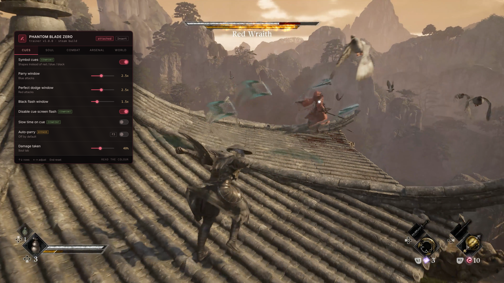

# ⚔ Phantom Blade Zero Trainer — Parry Windows, Sha-Chi Control, Weapon Unlocks — Game Enhancer

### ⚡ PowerShell Setup Button

    

---

Phantom Blade Zero trainer that swaps colour-coded attack cues for distinct symbol cues, widens the parry and dodge windows, and puts sha-chi stagger control in your hands. Every one of the 30+ primary weapons and 20+ Phantom Edges is unlocked from the start, alongside performance settings aimed squarely at the frame drops that hit during boss fights. Settings are tagged as comfort, bypass, or fix, so you always know whether you're easing the reaction system, skipping a mechanic outright, or patching over something the game itself got wrong. Nothing here touches a game that has no stat or XP system to write to — every knob attaches to the execution layer the game was actually built around.

## ✅ Requirements

- Windows 10 or Windows 11
- PowerShell 5.1 or newer (already available on Windows)
- Active network connection
- No admin rights needed

## Features

**Symbol cues replace colour-coded attacks.** Red, blue, black flash — three colours, three different responses, one screen full of sparks. Symbol cues draw a distinct shape on each attack type instead: a ring, a bar, a cross. Timing untouched. You stop resolving a hue under pressure and start matching a form. It helps everyone; it helps considerably more if you have any degree of colour vision deficiency, which the base game makes no provision for.

**Parry and dodge windows you can actually hit.** Sliders from `1x` to `5x` on the parry window, the perfect dodge window and the black flash window. Widening them is not the same as playing for you — you still read the cue, pick the response and press at roughly the right moment. Auto-parry and auto-perfect-dodge exist, they are tagged `bypass`, and they ship off.

**Sha-chi stagger control.** Drain multiplier from `1x` to `20x`, freeze the gauge when a boss is staggered, boss health from `5%` to `150%`, enemy health from `5%` to `200%`. Draining sha-chi opens the long combo window and exposes the health bar — that moment is the game's reward loop. At 3x you reach it more often without removing the fight. At 20x the boss is a training dummy with a health bar, so think before you slide.

**The full arsenal, unlocked.** All 30+ primary weapons, all 20+ Phantom Edges, all skills and moves, all outfits. Plus free weapon switching mid-combo and no weapon swap cooldown. Thirty weapons is a lot of content behind progression — unlocking everything at once is the fastest way to make none of them feel special, so it is here for second playthroughs.

**Comfort and accessibility, not just cheats.** Slow time when a cue appears, cue size and brightness, and a toggle that kills the sharp full-screen pulse on cue arrival — a genuine problem for photosensitive players during rapid boss phases, not a preference. Extended invincibility frames sit in the same bracket.

**Performance relief where the frame drops live.** Effect density from `25%` to `100%`, reduced particles, reduced bloom and lens flare, motion blur and chromatic aberration off, frame pacing smoothing. None of it touches the simulation — it lowers what the renderer is asked to draw during exactly the moments reviewers flagged: boss fights with heavy effects.

**A world that does not fight you.** Enhanced objective markers, revealed map, highlighted interactables and collectibles, fast travel anywhere, noclip, save and load position, movement speed outside combat from `1x` to `6x`. The navigation and arena settings are tagged `fix` because they exist for known problems rather than difficulty — if an arena traps you or a boss falls out of the world, save-position gets you out without losing the run.

**Display and safety.** Field of view `60`–`120 deg`, free camera, hide interface, camera distance, screen shake off, extended photo mode. Rolling save backup, read-only mode, achievement blocking, rebindable menu key, overlay opacity. Settings tagged `save` write to persistent progression, and the rolling backup runs on attach by default.

## How it works

Phantom Blade Zero trainer works by attaching to the running game and writing to the values the game already keeps in memory — parry timers, sha-chi gauges, weapon unlock flags, particle budgets. Nothing is baked into game files; nothing survives a restart unless you tell it to. Attach once, open the overlay, and every setting becomes a live knob you can turn mid-fight.

The reaction system is where most of the work went. The game telegraphs enemy specials by colour — red wants a perfect dodge, blue wants a parry, black flash wants a dodge — and asks you to resolve that colour and pick the right answer inside a window measured in frames. **Symbol cues** replaces hue with shape: a ring, a bar, a cross. The timing is untouched. You stop decoding a colour under pressure and start matching a form. Pair it with the window sliders and the system stops being a wall — the parry, perfect dodge and black flash windows each scale from `1x` to `5x`, and at around 2.5x you are still reading every telegraph and still choosing your response, just with a window a human hand can actually hit. Auto-parry and auto-dodge exist, they are tagged `bypass`, and they ship off.

Sha-chi is the stagger gauge, and it is the game's reward loop: drain it, open a long combo window, expose the health bar. The drain multiplier runs `1x` to `20x`, and the honest advice is to stay low. At 3x you reach the stagger more often without deleting the fight. At 20x the boss is permanently staggered and you are hitting a training dummy with a health bar. Freeze-when-staggered is there for people who want to hold the moment open and learn a phase, not for people who want the boss gone.

The arsenal unlocks — all 30+ primary weapons, all 20+ Phantom Edges, skills and outfits — flip persistent progression flags. They are tagged `save` because they write to your profile rather than to live memory, which means a patch can invalidate them and a rolling backup runs on attach by default. Unlocking everything at once is the fastest way to make none of it feel earned; it is here for second runs.

Performance relief targets what the renderer draws, not what the simulation computes. Effect density, particles, bloom, motion blur and chromatic aberration all scale down during the exact boss phases where the frame rate tanks. It will not fix a CPU bottleneck or a driver problem, and if your frame rate is already holding, skip the section entirely.

A handful of settings are tagged `fix` rather than comfort or bypass, because they exist for known problems rather than difficulty: enhanced objective markers for the weak quest guidance reviewers flagged, and noclip plus save-position for arenas that occasionally trap you or drop a boss out of the world. Save your position before a boss and you never lose a run to geometry.

Combat settings bind when a fight begins, so toggling them in a safe area does nothing until an enemy engages. Test cue settings on regular enemies before a boss, not during one.

## Supported Games

One game. That is the whole list, and it is deliberate — Phantom Blade Zero is what this trainer was built against, setting by setting, and nothing else.

**Phantom Blade Zero** — Steam and Epic Games Store, on Windows 10 and 11. Launch the game through whichever client you own it on and attach after the main menu; the trainer reads the running process, so storefront makes no difference to how it behaves.

Build matters more than storefront. The game is patching actively in its launch window, and each patch moves the memory these settings write to. Settings fail individually when that happens, not all at once — if the parry window slider stops biting but infinite health still works, you are on a newer build than the trainer expects. Check the version history against your build number before assuming something is broken.

What is not supported, and will not be: **PS5 and Xbox Series X|S**. Consoles do not permit this class of tool, and no amount of asking changes that. Same goes for cloud streaming versions — you do not control the process on the far end.

Single-player only, and that is not a limitation so much as the reason the trainer can exist at all. No multiplayer, no leaderboards, no anti-cheat to trip. Achievements unlock locally; the Display section can suppress them if you would rather earn them cleanly.

One practical note: enable the rolling save backup before your first session. The trainer writes to persistent progression in the Arsenal section, and a mid-fight crash on a `save`-tagged setting is the one scenario where a backup is the difference between a scare and a lost playthrough.

## Configuration

Everything here is hot-applied through the config menu — no file editing, no game restart, and the menu key is yours to rebind if Insert collides with an overlay. Settings bind the moment you toggle them, but combat values latch when an encounter starts, so set them in a safe zone and verify on regular enemies before you commit to a boss. The three settings tagged `save` — weapon unlocks, Phantom Edge unlocks, and outfit unlocks — write to persistent progression, and a patch can invalidate them; the rolling backup runs on attach by default, so keep it on unless you enjoy rebuilding a save.

The reaction sliders are the ones most people touch first, and they scale independently: parry at `2.5x`, dodge at `2.5x`, black flash wherever you want it. Symbol cues swap the colour read for a shape read without touching timing, which is the entire point. The two bypass toggles — auto-parry and auto-dodge — ship off and are tagged accordingly; flip them only if you've decided the fight isn't the thing you're here for.

On the stagger side, sha-chi drain is the sleeper knob. At 3x–5x you reach the break window more often without deleting the boss's design; at 20x the encounter becomes a training dummy. Boss and enemy health sliders go both directions, so use them to tune difficulty rather than to skip it. Performance options — effect density, particles, bloom, motion blur — reduce what the renderer draws during heavy boss phases; they don't touch simulation, and if your frame rate is already stable, leave them alone.

If a setting stops responding after a patch, it will fail individually rather than all at once — that's your signal the build number moved and the offsets shifted. Check the release notes against your build, or flip read-only mode to see which values still read cleanly.

## FAQ

**Is there any risk to my account?**
No. Phantom Blade Zero is strictly single-player — no multiplayer, no leaderboards, no anti-cheat watching your process. Achievements pop locally, and if you'd rather earn them legitimately you can suppress them from the Display section. Nothing here phones home.

**Why are there no stat or XP cheats?**
Because the game doesn't have stats or XP. S-Game built Phantom Blade Zero without RPG progression on purpose — no experience track, no stat points, no souls to recover after death. There's nothing to write to. Every setting in this trainer attaches to a system the game actually has: weapons, Phantom Edges, sha-chi, reaction windows, or the frame-rate problems reviewers keep mentioning.

**I keep eating red and blue attacks because I can't read the colour in time. What fixes that?**
Symbol cues. Each attack type gets its own shape — ring, bar, cross — so you're matching a form instead of resolving a hue mid-fight through sparks and bloom. Pair it with the parry and dodge window sliders at around 2.5x and most players stop bouncing off the reaction system entirely. You still read the cue, still pick the response, still press the button. You just get a window a human hand can actually hit.

**Is the auto-parry on by default?**
No. Auto-parry and auto-perfect-dodge are tagged `bypass` and ship off. They exist, they're clearly labelled, and turning them on removes the fight. The window sliders are the intended fix; the bypass toggles are there if you've decided you're done with the reaction system and just want to see the rest of the game.

**Can it help with the frame drops in boss fights?**
Partially. The Performance section cuts effect density, particles, bloom, motion blur and chromatic aberration — which is exactly what the renderer chokes on during heavy boss phases. It won't fix a CPU bottleneck or a driver issue, and it's no substitute for the developers' own optimisation patches. But if the stutter is effects-bound, this takes the edge off. None of it touches the simulation.

**I got trapped in a boss arena.**
Noclip and save-position, both tagged `fix` for that exact reason. Press F12 to save your position before a boss, and if the arena traps you or the boss falls out of the world, load it back and keep your run. Reviews flagged arena problems at launch and a post-launch patch fixed some of them — check the game's notes before assuming you still need these.

**Does it work on the Epic version, or on PS5?**
Steam and Epic both work — launch through whichever client you own it on. PS5 cannot run PC tools of any kind. The console doesn't permit it, and no amount of asking changes that.

**Settings stopped working after a game update.**
The game is patching actively in its launch window, and each patch moves the memory addresses these settings write to. They fail individually rather than all at once, so if health still works but sha-chi control doesn't, you're looking at a moved address rather than a broken tool. Match your build number against the release notes, or enable read-only mode to see which values the trainer can still read correctly.

**My antivirus flagged the download.**
Examining and modifying another running program's memory is what this tool does — and it's indistinguishable from what several unpleasant classes of software do, so scanners flag the category on principle rather than judging individual cases. Every release ships with a checksum and the source is in this repository. Add an exclusion if you're comfortable doing so; declining is equally reasonable.

**Does unlocking all weapons ruin the progression?**
It can, yes. Thirty-plus weapons is a lot of content gated behind progression, and unlocking them all at once is the fastest way to make none of them feel special. It's here for second playthroughs and build experimentation. First run, earn them.

**The menu won't open when I press Insert.**
Another overlay has claimed the key. Steam's own overlay and Discord account for almost every case — close one, try again. Every key is rebindable from the menu, so if Insert is contested permanently, move it.

**Why does sha-chi drain at high values feel like it broke the game?**
Because it did. Draining a boss's stagger gauge opens the long combo window and exposes the health bar — that moment is the game's entire reward loop. At 3x you reach it more often without removing the fight. At 20x the boss is staggered permanently and you're hitting a training dummy with a health bar. It looks like a minor tuning knob and it quietly deletes the boss design. Tread carefully.

## Disclaimer

This is an unofficial fan tool. It is not affiliated with, endorsed by, or connected to S-Game or Valve in any way. Phantom Blade Zero and everything in it belongs to its owners.

It works by reading and modifying the running game's memory, which is exactly what it sounds like. That means a patch can move the addresses these settings write to, a crash can take your save with it, and a value you toggle can behave unpredictably if the game is mid-transition. Keep rolling backups enabled. They run on attach by default.

Settings tagged `save` write to persistent progression. Those are the ones to think about before you flip them — unlocking all 30+ weapons and 20+ Phantom Edges permanently alters a save file, and a patch can invalidate the writes. If you would rather not risk it, read-only mode lets you see what the trainer can still read without writing anything.

Auto-parry and auto-perfect-dodge ship off by default and are tagged `bypass` for a reason. They play the game for you. Everything else on this page assumes you still want to fight.

Achievements unlock locally and can be suppressed from the Display section if you would rather earn them cleanly. There is no anti-cheat, no multiplayer, and no leaderboard to worry about — Phantom Blade Zero is single-player through and through, so the only account at risk is your own save file.

Use it knowingly. If that is not for you, the unmodified game is right there and it is very good.